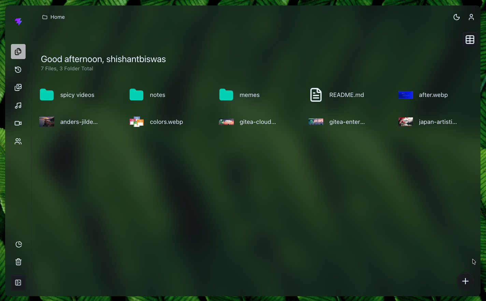
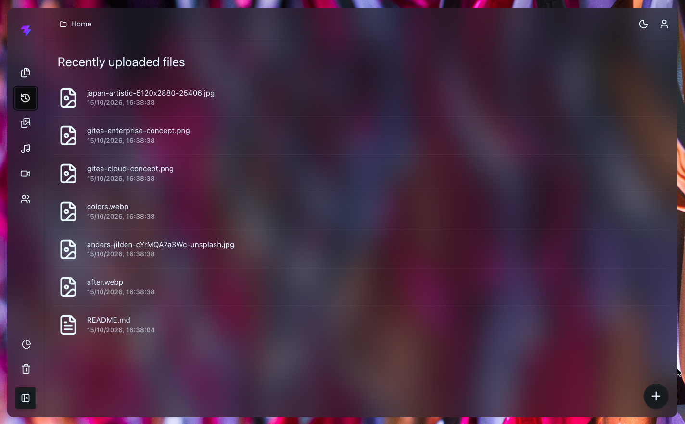
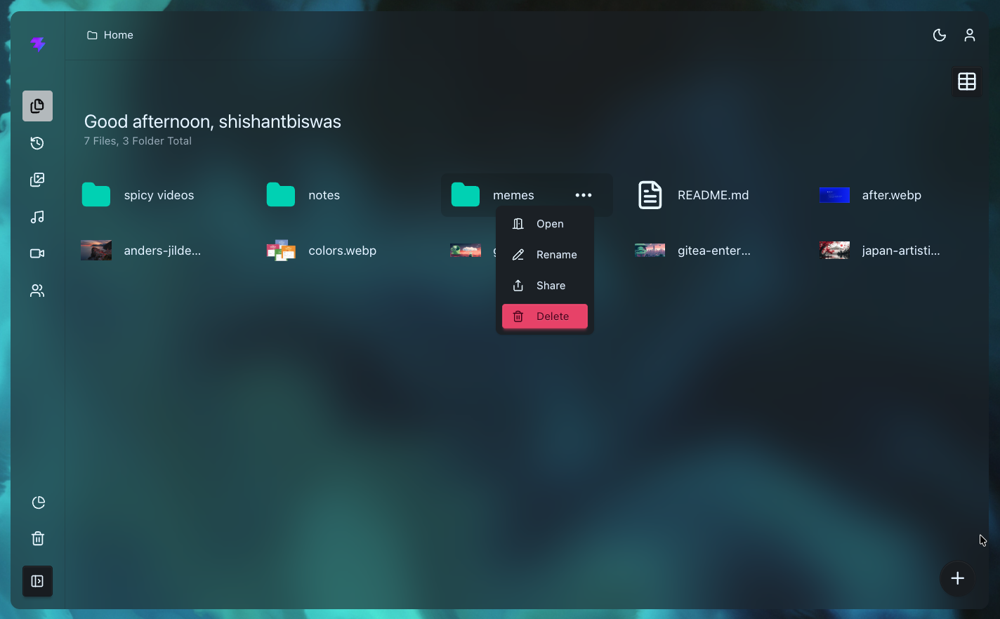
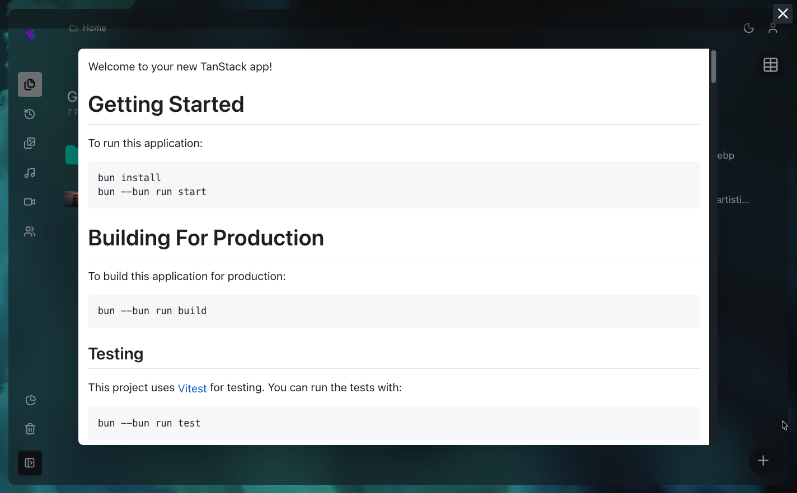
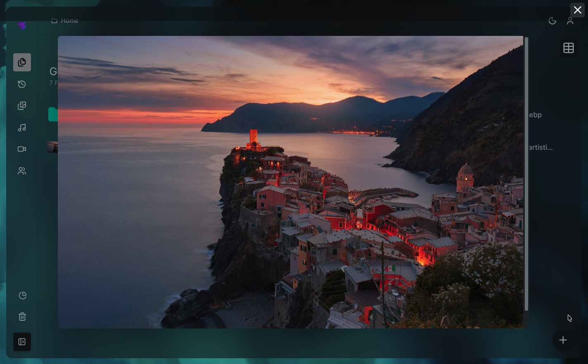
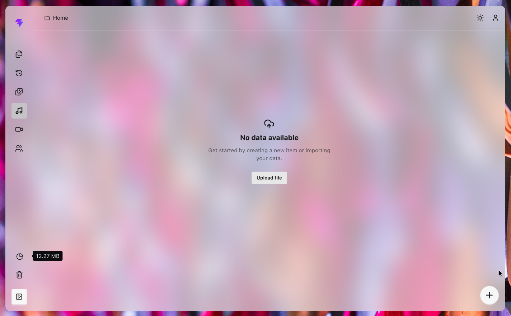
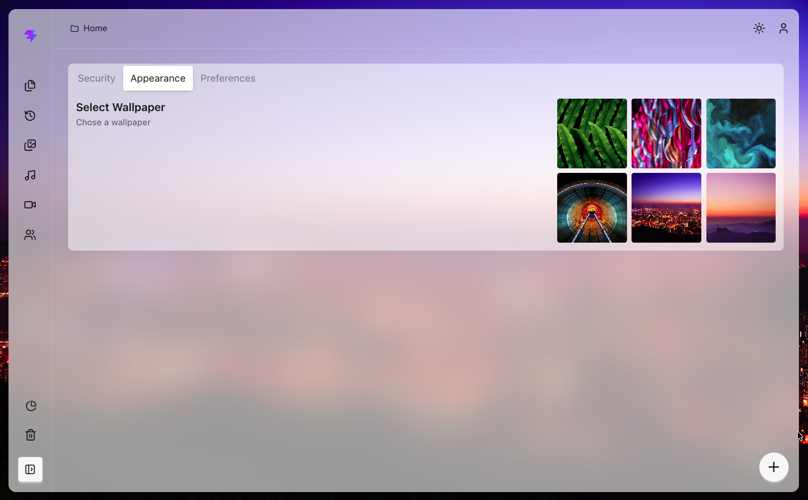
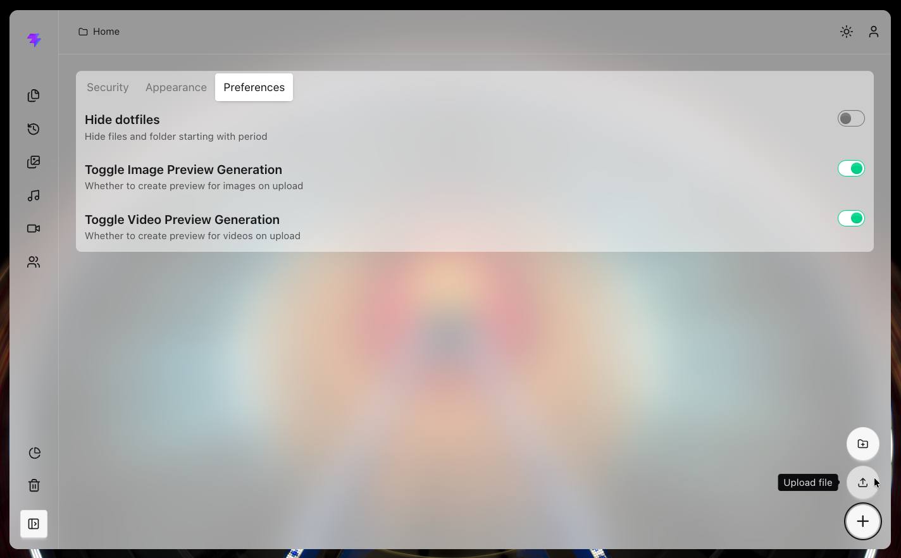

# NXC

A self-hosted, browser-based file drive for organizing and previewing files. Drive includes folders, image/video/audio views, uploads, sharing, and per-user appearance preferences.

## Features

- Organize files in folders and switch between grid and table layouts.
- Upload files, create folders, and view upload progress.
- Browse recent uploads, images, videos, and music.
- Preview supported files, including image and video previews.
- Share files, manage uploads, and restore or remove items from the trash.
- Customize the wallpaper and file-preview preferences.
- Store data locally or configure PostgreSQL, remote libSQL, or S3.

## Screenshots

Screenshots are in the [`screenshot/`](./screenshot/) folder.

| Home | Recently uploaded |
| --- | --- |
|  |  |

| File and folder actions | Markdown preview |
| --- | --- |
|  |  |

| Image preview | Empty music view |
| --- | --- |
|  |  |

| Appearance settings | Preferences |
| --- | --- |
|  |  |

## Requirements

- [Bun](https://bun.sh/)
- Node.js-compatible environment for the optional Docker deployment

## Run locally

```sh
bun install
bun run dev
```

The development server runs on [http://localhost:3000](http://localhost:3000). Local development uses `data.db` for the database and `./uploads` for uploaded files by default.

## Configuration

Create a `.env` file in the project root to configure the app. Development uses `data.db`; outside development the database defaults to local libSQL (`DB_TYPE=libsql`). File storage defaults to the local filesystem (`STORAGE_TYPE=local`).

| Variable | Purpose |
| --- | --- |
| `EMAIL`, `PASSWORD` | Set these credentials for the administrator account created when the database is seeded. |
| `JWT_SECRET` | Secret used to sign authentication tokens. Set a strong secret before deployment. |
| `DB_TYPE` | `libsql` (default), `sqlite`, `postgres`, `libsql-remote`, or `libsql-remote-embedded-replicas`. |
| `POSTGRES_URL` | Connection string required when `DB_TYPE=postgres`. |
| `LIBSQL_URL`, `LIBSQL_TOKEN` | Required for remote libSQL database modes. |
| `STORAGE_TYPE` | `local` (default) or `S3`. |
| `LOCAL_STOARGE_PATH` | Local upload directory; defaults to `./uploads`. |
| `S3_ACCESS_KEY`, `S3_SECRET_ACCESS_KEY`, `S3_URL_WITH_BUCKET` | Required when `STORAGE_TYPE=S3`. |
| `PORT` | Production server port; defaults to `3000`. |
| `MAX_BODY_SIZE` | Maximum request body size in bytes; defaults to 1 GiB. |
| `ENABLE_GUARD` | Configure the authentication guard; enabled by default in production. |

Do not commit `.env` or production credentials.

## Build and run

```sh
bun run build
bun run serve
```

The production server listens on port `3000` by default.

To run with Docker Compose, configure the `.env` file first, then run:

```sh
docker compose up --build
```

## Development commands

```sh
bun run dev      # Start the development server
bun run build    # Build client and server bundles
bun run serve    # Run the production server after building
bun run lint     # Lint the project with Biome
```
